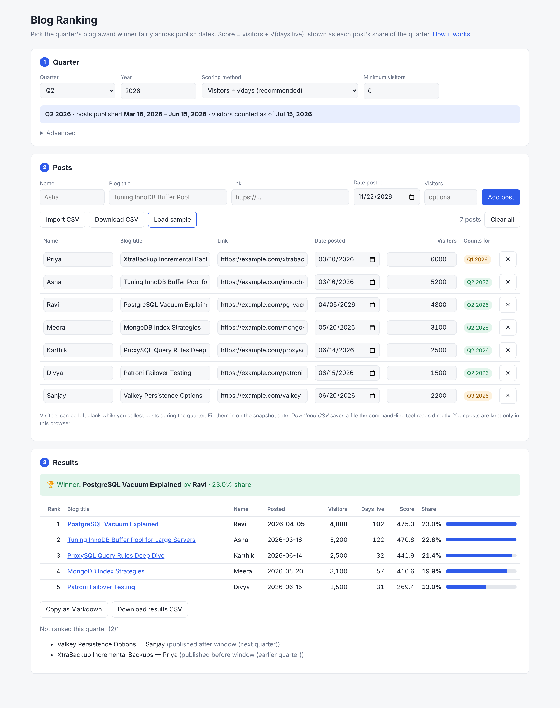

# Blog Ranking

A small command-line tool that picks the **quarterly blog award winners** from visitor counts, and stays fair when posts were published on different dates.

Ranking by total visitors favours old posts, because they have had more time to collect readers. Ranking by visitors per day favours new posts, because most readers arrive in a post's first couple of weeks. This tool divides visitors by the **square root** of days live, which sits between the two, and then gives each post its **percentage share** of the quarter.

The full reasoning is in [logic.md](logic.md).

There are two ways to use it, and both use the same logic and give the same results:

- **Web GUI** ([`docs/index.html`](docs/index.html)): add posts in a form, build the input CSV, and see the ranking live. Runs in the browser, no install needed.
- **Command line** ([`blog_ranking.py`](blog_ranking.py)): for scripted or repeatable runs from a CSV file.



## Web GUI

### Open it

- **Locally:** double-click `docs/index.html`. It opens in your browser and works offline.
- **Hosted on GitHub Pages:** in the repo, go to **Settings → Pages → Build and deployment**. Choose *Deploy from a branch*, branch `main`, folder `/docs`, then **Save**. The page appears at `https://<your-user>.github.io/<repo-name>/` after about a minute.

Everything runs in the browser. Posts are saved only in that browser's local storage, and nothing is sent to a server.

### Use it

1. **Quarter:** pick the quarter and year. The blue bar shows the publish window and the date visitor counts are taken on (for Q2: posts from Mar 16 – Jun 15, visitors as of Jul 15).
2. **Posts (CSV builder):** for each post, enter **Name**, **Blog title**, **Link**, **Date posted** and, once you have it, **Visitors**, then click **Add post**.
   - Every cell in the table can be edited in place. The *Counts for* column shows which quarter each post belongs to, and flags posts that still need visitors.
   - **Download CSV** saves the list as `posts_q2_2026.csv`, the input file for the command-line tool.
   - **Import CSV** loads a saved file, or merges a later export into your list: a row with the same title and date updates that post's visitors.
   - **Load sample** fills in example data. **Clear all** asks for a second click before clearing.
3. **Results:** the ranking updates as you type. The winner is shown at the top, and posts left out are listed with the reason. **Copy as Markdown** gives a table to paste into Confluence, Slack or GitHub. **Download results CSV** saves the full ranking.

A typical quarter: add each post as it's published, leaving visitors blank. On the snapshot date, fill in the visitor numbers (or import them), check the result, and copy the table for the announcement.

## Command line

Needs Python 3.8 or newer. No other packages are required.

```bash
git clone <your-repo-url> blogRanking
cd blogRanking
python3 blog_ranking.py examples/posts_sample.csv --quarter Q2 --year 2026 --show-excluded
```

```
Q2 2026 | publish window 2026-03-16 .. 2026-06-15 | visitors as of 2026-07-15 | method: sqrt
Eligible posts: 5   Excluded: 2

Rank  Title                                     Author   Published   Visitors  Days  Score  Share %
----  ----------------------------------------  -------  ----------  --------  ----  -----  -------
   1  PostgreSQL Vacuum Explained               Ravi     2026-04-05     4,800   102  475.3     23.0
   2  Tuning InnoDB Buffer Pool for Large Ser…  Asha     2026-03-16     5,200   122  470.8     22.8
   3  ProxySQL Query Rules Deep Dive            Karthik  2026-06-14     2,500    32  441.9     21.4
   4  MongoDB Index Strategies                  Meera    2026-05-20     3,100    57  410.6     19.9
   5  Patroni Failover Testing                  Divya    2026-06-15     1,500    31  269.4     13.0

Winner: "PostgreSQL Vacuum Explained" by Ravi (23.0%)

Excluded:
  - 2026-03-10 | XtraBackup Incremental Backups | Priya | published before window (earlier quarter)
  - 2026-06-20 | Valkey Persistence Options | Sanjay | published after window (next quarter)
```

To install it as a command instead:

```bash
pip install .
blog-ranking posts.csv -q Q2 -y 2026
```

## How the calculation works

### 1. Which posts count for a quarter

Each quarter's publish window is shifted back by 15 days. Posts from the last two weeks of a quarter move to the next one, so they get a fair amount of time to collect readers.

| Quarter | Posts published | Visitor counts taken on |
|---|---|---|
| Q1 | Dec 16 (previous year) – Mar 15 | Apr 14 |
| Q2 | Mar 16 – Jun 15 | Jul 15 |
| Q3 | Jun 16 – Sep 15 | Oct 15 |
| Q4 | Sep 16 – Dec 15 | Jan 14 (next year) |

Every date belongs to exactly one quarter. Visitor counts are taken **30 days after the window closes**, so even the newest eligible post has been live for at least 31 days.

### 2. The formula

```
Days live   = Snapshot date − Publish date + 1
Score       = Visitors ÷ √(Days live)
Percentage  = Score ÷ (sum of all eligible scores) × 100
```

The highest percentage wins. The percentages of all eligible posts add up to 100%.

**Worked example (Q2 2026, snapshot Jul 15):**

| Post | Published | Visitors | Days live | √Days | Score | Share |
|---|---|---|---|---|---|---|
| PostgreSQL Vacuum | Apr 5 | 4,800 | 102 | 10.10 | 475.3 | **23.0%** |
| InnoDB Buffer Pool | Mar 16 | 5,200 | 122 | 11.05 | 470.8 | 22.8% |
| ProxySQL Rules | Jun 14 | 2,500 | 32 | 5.66 | 441.9 | 21.4% |
| MongoDB Indexes | May 20 | 3,100 | 57 | 7.55 | 410.6 | 19.9% |
| Patroni Failover | Jun 15 | 1,500 | 31 | 5.57 | 269.4 | 13.0% |
| | | | | | **2,067.9** | **100%** |

For comparison, plain visitors ÷ days would make *ProxySQL Rules* the winner (78/day). It had about half the readers of the top two posts and wins only because it is the newest.

### 3. Same calculation in a spreadsheet

Put the snapshot date in `L1`, the window start in `L2` and the window end in `L3`. Data goes in columns A–D: Title, Author, Publish date, Visitors.

| Column | Formula (row 2, fill down) |
|---|---|
| E Eligible | `=AND(C2>=$L$2, C2<=$L$3)` |
| F Days live | `=$L$1-C2+1` |
| G Score | `=IF(E2, D2/SQRT(F2), "")` |
| H Share % | `=IF(E2, G2/SUM(G:G)*100, "")` |
| I Rank | `=IF(E2, RANK(H2, H:H), "")` |

## Input file

A CSV file with one row per post. Header names are not case-sensitive and columns can be in any order.

There are three ways to create it:

- Build it in the **Web GUI** and click **Download CSV**.
- Copy [`examples/posts_template.csv`](examples/posts_template.csv) (headers only) and fill it in with Excel, Google Sheets or a text editor.
- Export it from your analytics tool and rename the columns to match.

| Column | Required | Also accepted as | Example |
|---|---|---|---|
| `title` | yes | post, blog title | PostgreSQL Vacuum Explained |
| `author` | yes | name, writer | Ravi |
| `publish_date` | yes | published, date, posted, date posted | 2026-04-05 |
| `visitors` | yes | unique visitors, users, views | 4800 or 4,800 |
| `url` | no | link | https://… |

Accepted date formats: `2026-04-05`, `05/04/2026` (day first), `05-04-2026`, `05-Apr-2026`, `05 Apr 2026`.

Rows with a bad date or visitor value are skipped with a warning. The rest of the file is still ranked.

**Getting the numbers:** export **unique visitors** (Users in GA4) per post URL, from each post's publish date up to the snapshot date. Pull every post from the same report on the same day. Filter out internal and bot traffic first.

## Options

```
python3 blog_ranking.py CSV [options]
```

| Option | Default | What it does |
|---|---|---|
| `-q, --quarter Q1..Q4` | | Quarter to rank |
| `-y, --year YEAR` | | Year of the quarter |
| `-m, --method` | `sqrt` | `sqrt` (recommended), `perday` (visitors ÷ days), `raw` (total visitors) |
| `--min-visitors N` | `0` | Posts with fewer visitors are not ranked |
| `--top N` | all | Show only the top N |
| `-f, --format` | `table` | `table` or `markdown` (paste into Confluence, Slack or GitHub) |
| `-o, --output FILE` | | Also save the full results as CSV |
| `--show-excluded` | off | List posts left out, and why |
| `--shift-days N` | `15` | How far the publish window is shifted back from the calendar quarter |
| `--lag-days N` | `30` | Days after the window closes to take visitor counts |
| `--window-start`, `--window-end`, `--snapshot` | | Set the dates by hand instead of using `--quarter`/`--year` |

### Examples

```bash
# Standard Q2 run
python3 blog_ranking.py data/q2_2026.csv -q Q2 -y 2026

# Top 3 only, as a markdown table, saving full results
python3 blog_ranking.py data/q2_2026.csv -q Q2 -y 2026 --top 3 -f markdown -o results/q2_2026.csv

# Ignore posts under 300 visitors
python3 blog_ranking.py data/q2_2026.csv -q Q2 -y 2026 --min-visitors 300

# Your numbers were pulled on Jul 20 instead of Jul 15
python3 blog_ranking.py data/q2_2026.csv -q Q2 -y 2026 --snapshot 2026-07-20

# Custom period
python3 blog_ranking.py data/h1.csv --window-start 2026-01-01 --window-end 2026-06-15 --snapshot 2026-07-15
```

## Running each quarter

1. **During the quarter:** add each new post (name, title, link, date) in the GUI, or as a row in your CSV.
2. **On the snapshot date** (for example Jul 15 for Q2): export unique visitors for every post published in the window, and fill them in.
3. **Check the excluded list** (GUI, or `--show-excluded` on the command line) so no post was left out by mistake.
4. **Announce** the winner with the share %, and attach the markdown table.

Keep real exports in a `data/` folder. It is git-ignored, so real numbers stay off GitHub.

## Tests

```bash
python3 -m unittest discover -s tests -v
```

## Project layout

```
blogRanking/
├── blog_ranking.py            # command-line tool (standard library only)
├── docs/
│   ├── index.html             # web GUI: CSV builder + ranking (single file, no dependencies)
│   └── screenshot.png
├── examples/
│   ├── posts_sample.csv       # sample input
│   └── posts_template.csv     # empty template to fill in
├── tests/
│   └── test_blog_ranking.py
├── .github/workflows/tests.yml  # runs the tests on every push
├── README.md                  # how to use it
├── logic.md                   # why the formula works this way
├── pyproject.toml             # lets `pip install .` add a `blog-ranking` command
└── LICENSE                    # MIT
```

## Contributing

Issues and pull requests are welcome. If you change the ranking logic, update **both** `blog_ranking.py` and the `rank()` function in `docs/index.html` so they stay in step, add a test, and update [logic.md](logic.md).

## License

[MIT](LICENSE)
